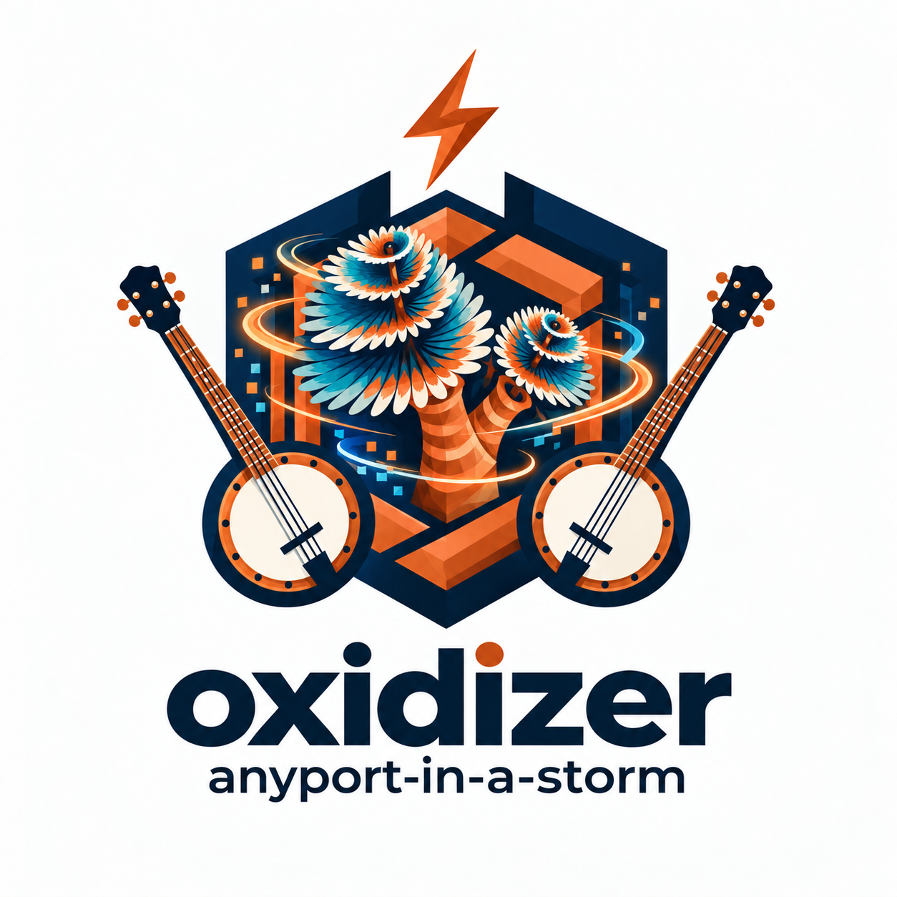

# ⚡ anyport-in-a-storm (oxidizer)
v0.0.9
**Machine-speed reflex-action tooling for actors defending machine-speed threat models.**

> [!CAUTION]
> **Pre-production.** Await v1.0.0 before using this in production or regulated deployments.
> *Oxidizing pqc-amplification DDoS packets, one subnet at a time.*

"**Sudo** for **AI.** What could possibly go wrong." — anon 2027


<p align="center">
  
</p>


Welcome to the public repo for **anyport-in-a-storm** (internally, **`oxidizer`**) — first in a suite of PQC-aware, machine-speed tools for threat-model actors. It runs at **Tier-2 timing** (post-SKB, the same early window as Generic XDP) with **Tier-2 *and* Tier-3 availability** — no driver, hypervisor, or NIC cooperation required.

It's not an app, process or systemd: it simply an ultra-lightweight `nftables` firewall provisioner written in modern Rust (Edition 2024). It works for us — we provide its binary to our autonomous-ai who acts as sentinal to all our metal, actually in production throughout the `rustykey.io` and `rustykey.me` infrastructure suite. Please do not use without sandboxing and testing first.

Do we stand behind it? Yes. This is the same tool we use in our production environments, so we're betting the ranch, *our* ranch, on Kerckhoffs's Principle holding.

---
## The Post-Quantum Cryptography (PQC) DDoS Vector

As the internet transitions to Post-Quantum Cryptography, servers must handle cryptographic primitives orders of magnitude larger than legacy Elliptic Curve or RSA:

| Cryptographic Scheme | Signature / Key Size |
|---|---|
| **SQIsign-L1** | ~200 bytes |
| **ML-DSA-44** | ~2,420 – 4,595 bytes |
| **FN-DSA-512** | ~666 – 1,280 bytes |
| **SLH-DSA-SHA2-128s** | Up to **7,856+ bytes** |
| **ECDSA (not quantum-resistant)** | ~64 bytes |


### The threat: PQC-amplified handshake floods

Because PQC public keys and signatures require transmitting thousands of bytes per TLS/SSH client-hello, a malicious actor can orchestrate a **PQC-amplified DDoS**. By firing hundreds of malformed or oversized PQC negotiation packets per second from a distributed botnet, bad actors can exhaust CPU state tables, saturate ingress buffers, and grind even powerful edge nodes to a halt — *even with perfectly optimized application code*. And as selective-disclosure stacks multiple signatures *inside* an already-signed document, that amplification compounds further.

### How `oxidizer` mitigates this risk

`oxidizer` filters at the nftables netdev-ingress hook (`NF_NETDEV_INGRESS`) — the earliest point the standard netfilter stack allows, binding directly to the interface (`ingress device "eth0"`). So it isn't eBPF/XDP, not Tier 0/1 — but does drop malicious IP blocks from high-risk or telemetry-heavy regions *before* the packet reaches conntrack table allocation, routing lookup, or a single memory-intensive PQC validation routine.

It helps automate and speed up a plain kernel feature, available on most Linux hosts — including the ~75% of the market where XDP isn't an option at any level. It's Rust, not shell, because it's meant to be wielded by machines: it isn't an API, a daemon, or a systemd service — it expects an automated defensive agent to monitor telemetry, compute the threat dynamically, and command the firewall to drop or allow traffic in response.

---

## Quick Start

```bash
cargo build --release
sudo ./target/release/fw --test
```

📖 Docs: https://antonymott.github.io/anyport-in-a-storm-oxidizer/

## Check, Lint, Test, Build, Deploy

```bash
# --- Check, lint, format, test ---
cargo check -p oxidizer-firewall                                # fast type-check, no codegen — run this constantly
cargo clippy -p oxidizer-firewall --all-targets -- -D warnings  # lint — run before every commit
cargo fmt                                                        # format the whole workspace
cargo test -p oxidizer-firewall                                 # unit tests (network.rs, countdown.rs, etc.)

# --- Build ---
cargo build -p oxidizer-firewall             # debug build   -> target/debug/fw
cargo build -p oxidizer-firewall --release   # release build -> target/release/fw

# --- Build + run in one step ---
cargo run -p oxidizer-firewall -- flushinoneminute
cargo run -p oxidizer-firewall --release -- flushinoneminute
cargo run -p oxidizer-firewall --release

# --- Direct binary execution (requires root) ---
sudo ./target/release/fw flushinoneminute --geoipblock=false
sudo ./target/release/fw flushinoneminute
sudo ./target/release/fw

# --- Confirmed-good ruleset -> persist it ---
sudo nft list ruleset > /etc/nftables.conf
```

### Global Cloud Instances by eBPF/XDP Reflex-Layer Accessibility
*(This table describes eBPF/XDP hook accessibility specifically — not `oxidizer`, which operates via the netfilter-based ingress hook, unavailable to eBPF/XDP. Related, but architecturally separate. Tiers count down from most common/least capable (Tier 3) to rarest/most capable (Tier 0).)*

| Tier | Mechanism | Est. Market Share | Est. Instance Count | Typical Hosts | Reality Check |
|---|---|---|---|---|---|
| **Tier 3 — Hypervisor Block** | No eBPF/XDP hooks (traditional `sk_buff` networking only) | ~75% | ~22,500,000 | Hyperscalers (AWS EC2/Lightsail, GCP, Azure), traditional shared VPS (Linode, Akamai, standard instances) | **No reflex.** Packets traverse the host's virtual switch (Open vSwitch, AWS Nitro) before reaching your VM. Your OS handles them via the standard slow-path kernel buffer. No inline XDP drops possible. |
| **Tier 2 — Emulated Sandbox** | `XDP_SKB` / Generic Mode (software emulation above the OS stack) | ~24.5% | ~7,350,000 | Modern developer clouds (Hetzner Cloud, DigitalOcean, Vultr, Scaleway, OVHcloud VPS) | **Borrowed reflex.** XDP programs load, but the hypervisor forces Generic Mode — the OS has already allocated metadata, burned CPU cycles, and fired interrupts before your program sees the packet. You skip user-space but miss line-rate flood speeds. |
| **Tier 1 — True Native Reflex** | `XDP_DRV` / Native Mode (runs inside the hardware driver) | ~0.49% | ~147,000 | Dedicated bare metal (Hetzner Dedicated, OVH Dedicated, Vultr Bare Metal, colocation) | **True reflex.** Code runs the moment a packet leaves the ring buffer — evaluated and dropped in nanoseconds. Requires a physical NIC driver with native XDP support. |
| **Tier 0 — The Absolute Edge** | `XDP_ZEROCOPY` (direct hardware DMA to memory space) | < 0.01% | ~3,000 | Custom bare metal with enterprise NICs (Intel i225/i226/ICE, Mellanox ConnectX-5+) | **Zero-copy reflex.** The NIC uses DMA to hand packets straight to your AI's memory block (UMEM) — zero CPU copies. Only available to teams running custom metal with specific enterprise NIC configurations. |

*(Numbers are estimates and change over time.)*